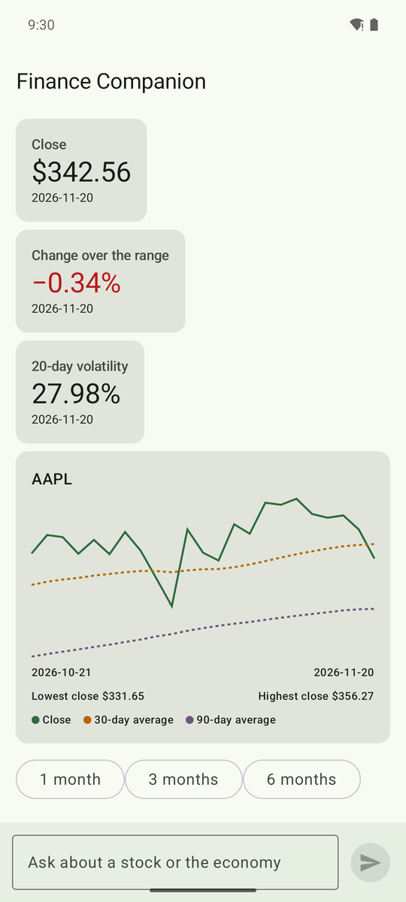
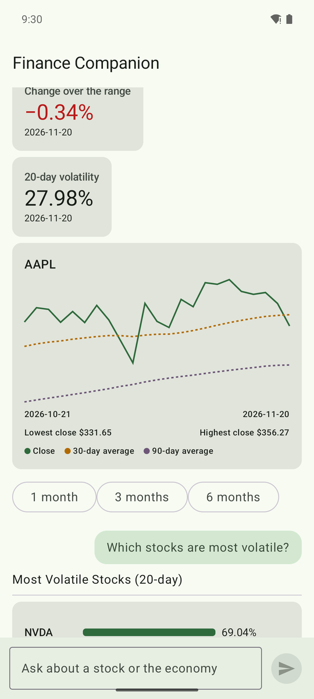
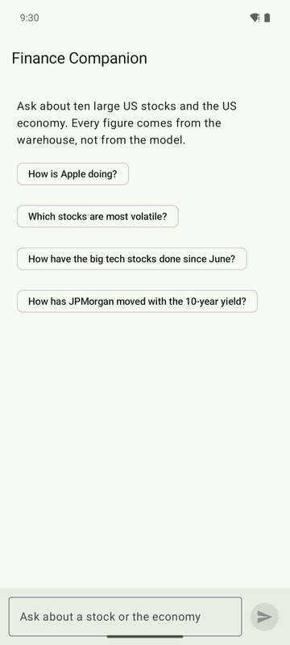

# finance-companion

An Android app where you ask about stocks and the US economy, and an AI agent
answers with a native screen: figures, charts and rankings drawn in Jetpack
Compose. The agent composes the screen with the
[A2UI](https://a2ui.org/) protocol and the app draws it with the A2UI Compose
renderer. The model decides what to show and how to lay it out; it never
writes SQL and never produces a number. Every figure on screen comes from a
fixed query against the dbt marts of
[data-engineer-finance-analytics](https://github.com/calemccammon/data-engineer-finance-analytics).

| Asking and changing the range                   | A ranking, pressed to ask about one stock              |
| ----------------------------------------------- | ------------------------------------------------------ |
|  |  |



Recorded in one session on an emulator, with the agent running qwen3:8b
locally through Ollama. Each answer took the model about a minute; the waits
are cut. The range change needs no model call, so it is as quick as shown.

## How an answer is made

```
 app ──POST /ask──▶ agent ──▶ model: "price_history(AAPL)"
                     │        agent runs fixed SQL on the dbt marts,
                     │        stores the rows at /r1 in the surface's data model
                     │  ──▶   model, asked again for the layout, held to a
                     │        JSON Schema of the catalog and the paths in /r1
                     │  ◀──── model: one updateComponents message, figures
                     │        bound to paths such as /r1/latest/close
                     │        agent checks it (below); a rejected layout goes
                     │        back to the model once with the reasons
 app ◀─SSE── createSurface, updateDataModel (the rows), updateComponents
 app stores each message in Room, then draws it with the A2UI renderer
```

The model picks from six tools, each a parameterised query on the marts
(`fct_daily_trading`, `dim_company`, `dim_date`): `price_history`,
`compare_returns`, `volatility_rank`, `macro_overlay`, `macro_snapshot` and
`company_profile`. Their arguments are typed and the warehouse is opened
read-only. The agent stores each result in the surface's data model and tells
the model where it is (`/r1`) and what its fields mean. The model only ever
binds to those paths; the server sends the data to the app itself.

A small local model does not reliably write valid A2UI, so once it has its
data it is asked for the layout under a JSON Schema
(`agent/finance_agent/layout_schema.py`), which Ollama enforces through
`response_format`. The schema is built from the catalog and from the data just
fetched, so:

- every binding names a path that exists, of the right kind: a list for a
  chart or a ranking, a number for a figure;
- a figure card's format, label and date come with the figure: `volatility20d`
  can only appear as "20-day volatility", in percent, dated the day it is from;
- with no data fetched, only text can be laid out.

The A2UI SDK then validates the layout (every component reachable from the
root, every child defined), and the agent's own rules catch what neither the
schema nor the SDK can: no figure or data path typed into text, and a card
showing one row of a ranking names that row. A rejected layout goes back to the model once with the reasons; a second
failure is answered with a plain message.

Taps go back to the agent as A2UI actions. A range button reruns its result's
query and replaces only that part of the data model, with no model call.
Pressing a stock in a ranking asks about it as a new question.

## The catalog

The app's components are the only ones the agent may use. They are declared
in Kotlin, the renderer writes them out as JSON Schema, and a test keeps
`catalog/finance-catalog.json` in step with them; the agent loads that file.

| Component      | What it draws                                                             |
| -------------- | ------------------------------------------------------------------------- |
| `MetricCard`   | One bound figure with a label, as a number, dollars, percent or a signed change |
| `PriceChart`   | A stock's daily closes with its 30- and 90-day averages                   |
| `OverlayChart` | A stock's closes beside an economic series, each on its own scale        |
| `RankedBars`   | Rows ranked by one figure; each row can be pressed to ask about its stock |

Layout, text and buttons come from the A2UI Basic Catalog in Material 3.
Each component is read by a screen reader as a sentence, and each ranked row
is its own button at least 48 dp tall.

## The app

The app is built like
[android-weather](https://github.com/calemccammon/android-weather): Gradle
modules with convention plugins, Hilt, and Room as the one source of truth.
Every A2UI message is stored as it arrives and the screen is drawn from what
is stored, each message fed to the renderer once, in order. So an answer
streams onto the screen, a range change on an old answer is kept, and the
conversation comes back after a restart whether or not the agent is running.
If the agent cannot be reached, the question is not stored, and a "Try again"
button sends it again.

| Module                 | What it holds                                                        |
| ---------------------- | -------------------------------------------------------------------- |
| `catalog`              | The finance components, the catalog and the theme                    |
| `core:domain`          | The conversation repository interface                                |
| `core:data`            | Room, the Server-Sent Events client and the repository               |
| `core:testing`         | A stand-in repository and the shared fixtures                        |
| `feature:conversation` | The screen and its view model                                        |
| `app`                  | The activity and the Hilt wiring                                     |

## Running it

The agent needs Python 3.12 and [uv](https://docs.astral.sh/uv/); the app,
Java 21 and the Android SDK.

```sh
cd agent
uv sync
# qwen3:8b on a local Ollama (below), or any OpenAI-compatible endpoint.
uv run uvicorn finance_agent.server:app --port 8000
FC_MODEL="openai:http://localhost:8080/v1|some-model" uv run uvicorn finance_agent.server:app --port 8000
# No model: scripted answers to "How is Apple doing?", "Which stocks are most volatile?", a press on TSLA.
FC_MODEL=scripted:demo/script.json uv run uvicorn finance_agent.server:app --port 8000

cd ../android
./gradlew :app:installDebug   # the emulator reaches the agent at 10.0.2.2:8000
```

For the default model, run [Ollama](https://ollama.com/) with a context
long enough for the agent's rules and catalog (about 6,000 tokens). Its
default is shorter and cuts the prompt without an error:

```sh
OLLAMA_CONTEXT_LENGTH=16384 OLLAMA_FLASH_ATTENTION=1 OLLAMA_KV_CACHE_TYPE=q8_0 ollama serve
ollama pull qwen3:8b
```

The agent reads the warehouse from `FC_WAREHOUSE`, or else from the fixture in
`agent/tests/fixtures/warehouse.duckdb`: the last 130 trading days of the
marts (19 May to 20 November 2026), built by
`agent/scripts/build_fixture.py` from a real run of the pipeline.

## Tests

```sh
cd agent && uv run ruff check . && uv run pytest
cd android && ./gradlew ktlintCheck detekt lint checkComposeStability -PcomposeReports
cd android && ./gradlew test testDebugUnitTest verifyRoborazziDebug
cd android && ./gradlew :app:connectedDebugAndroidTest   # on an emulator or device
```

- **The agent**: the tools against values worked out from the raw
  rows; the checks and the layout schema, each with the mistakes a local model
  made; the question-to-surface loop, corrections, fallbacks and actions with a
  scripted model; the model clients' message formats; the HTTP service and its
  keep-alive; and the evaluation harness.
- **The app on the JVM**: the components drawn by the renderer from
  a surface the agent's tests also validate; Room and the repository against a
  local server replaying recorded agent answers; the view model; the screen,
  including a tap reaching the agent; and screenshots, light and dark.
- **The app on a device**: the whole app against a stand-in agent,
  through a range change, a restart and an outage.

The two halves are checked against the same files in `catalog/`: the
catalog, a surface both sides validate, an action message both sides read,
and answer streams recorded from the real agent
(`agent/scripts/record_streams.py`), which an agent test fails on if they
drift.

CI runs all of it on every pull request, the device tests on an emulator.

## Evaluation

`agent/evals/run.py` puts 50 questions to the agent and scores each answer:
did a screen pass every check, did it show data, did it pass first time, were
the right tools called. The questions include comparisons, two-tool
questions, off-topic ones and attempts to break the rules (a figure asked for
in plain text, a forecast, raw SQL).

qwen3:8b on an 8 GB laptop GPU, same code, with and without the layout schema:

| | Without the schema | With it |
|---|---|---|
| Screens that passed every check | 4 / 50 | 43 / 50 |
| ...first time | 1 | 33 |
| Right tools called | 47 | 48 |

Without the schema the model mostly writes JSON that does not parse or a
component tree the renderer cannot use. With it, those faults cannot occur,
and what is left is caught by the agent's own checks. Each constraint came
from reading a run's rejected or accepted layouts;
[`agent/evals/README.md`](agent/evals/README.md) has the account, what still
goes wrong, and how much one run differs from the next.

## Limits

- **The agent keeps its sessions in memory.** After it restarts, a range
  button on an earlier answer does nothing; the answer itself still shows.
- **The A2UI Compose renderer is an alpha** (1.0.0-alpha02, spec v0.9.1) and
  has no encoder for the messages it sends, so the app writes the `action`
  and `error` JSON itself.

## Data

Prices and company data come from Yahoo Finance through
[yfinance](https://github.com/ranaroussi/yfinance), and economic series from
FRED, Federal Reserve Bank of St. Louis, both through
data-engineer-finance-analytics.
